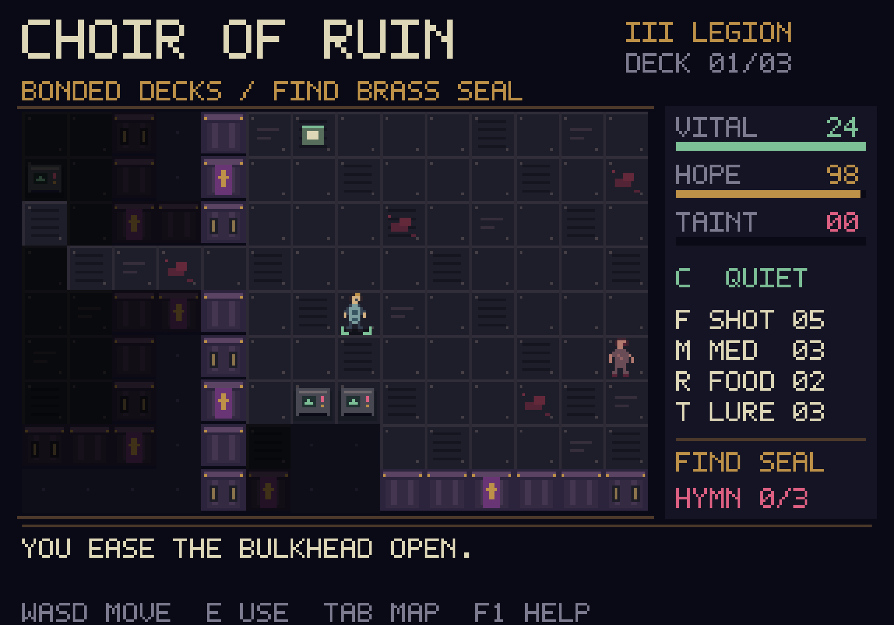

# Choir of Ruin

A C++17 survival roguelike with a Mega Drive-inspired pixel-art presentation.
You are Serf 713 aboard the Emperor's Children cruiser *Canticle of Excess*
as its masters fall to Chaos. Cross three decks, recover the transit seals
and reach a cutter before the ship's song becomes your own.



## Play locally

On this Mac, double-click **Play.command**, or run:

```sh
./Play.command
```

Requires a C++17 compiler, CMake 3.16+ and SDL2 development files. SDL2 and
CMake were already installed on the development Mac. To build manually:

```sh
cmake -S . -B build -DCMAKE_BUILD_TYPE=Release
cmake --build build --parallel
./build/choir
```

Use `./build/choir --seed 713` to replay a layout, or `--small` for a 640x448
window. The default window is 1280x896. Rendering uses 320x224 logical pixels
and nearest-neighbour integer scaling, with letterboxing when necessary.
This is a native desktop game inspired by the console's look, not a ROM.

## Controls

| Key | Action |
| --- | --- |
| Enter | Begin, or start a fresh run after an ending |
| WASD / arrows | Move, open a bulkhead, or attack an adjacent enemy |
| E | Use a lift, help a serf, or accept a shrine's gift |
| F | Shoot the nearest visible enemy within eight paces |
| T | Throw scrap up to seven tiles in the last movement direction |
| C | Toggle quiet movement |
| M | Use medicae, restoring up to 12 health |
| R | Eat a ration, restoring up to 35 hope |
| Space / . | Wait one turn |
| F1 / Escape | Field manual and pause |
| Tab | Remembered deck map and pause |
| Q | Quit from the title, map, pause or ending screen |
| Mouse hover | Inspect visible objects and threats |

The small blue-grey figure with green foot markers is you. Walk over supplies
to collect them. The brass seal unlocks the deck's lift. Supplies, health, hope
and taint carry between decks. Each new deck needs its own seal.

Time advances when you take a successful action. Reading the manual, changing
stance, hitting a wall or attempting an unavailable action costs no turn.
Opening a bulkhead takes one turn before you can walk through it.

Quiet movement reduces detection range. A shot can alert enemies beyond your
vision. Thrown scrap draws enemies towards its landing point unless they can
already see you. Machinery and bulkheads block sight. Unseen areas are hidden
and visited areas remain dimly remembered.

A fallen Legionary has armour your pistol barely scratches. Avoid him, draw
him away or break sight. Hope drains over time and under attack. With no hope,
taint rises each turn. Shrines heal fully for 22 taint. At 100 taint you join
the choir. Health loss means death. Both end the run permanently.

Helping other serfs restores hope and changes your ending tally. Your taint
also changes the escape text.

## Scope

This is a playable first slice: three generated decks, three threat types,
scavenging, sight and noise, rescue, temptation, combat and escape endings.
It currently has no save system, sound, controller support or campaign.
Balance has automated checks but still needs human playtesting. The deck
topology uses a room grid with random room sizes and vertical connections.
Sprites are static, original 16x16 pixel drawings authored in C++.

The ship and characters are an original fan scenario around the Horus Heresy,
within the history of the Warhammer 40,000 setting. Warhammer names belong to
their respective owners. No Games Workshop art or game code is included.
The former Windows Forms prototype is preserved under `legacy/`, outside the
new build. Its previously tracked build artefacts are preserved there too.

## Development

- `src/game.*`: procedural generation, state and deterministic turn resolution.
- `src/view.*`: pixel sprites, tiles, camera, bitmap text and screen states.
- `src/main.cpp`: SDL lifecycle, keyboard mapping and screenshot smoke runner.
- `tests/game_tests.cpp`: engine contracts, generation, simulation and journey.
- `tests/view_tests.cpp`: screen rendering, fog masking and rendering invariants.
- `docs/DESIGN.md`: brief, specification, references and acceptance criteria.
- `docs/VERIFICATION.md`: local verification results and limitations.

```sh
ctest --test-dir build --output-on-failure

# Engine-only build, with no SDL dependency
cmake -S . -B build-tests -DCHOIR_BUILD_APP=OFF
cmake --build build-tests --parallel
ctest --test-dir build-tests --output-on-failure

# Clang / GCC address and undefined behaviour sanitisers
cmake -S . -B build-sanitised -DCHOIR_BUILD_APP=OFF -DCHOIR_SANITISE=ON
cmake --build build-sanitised --parallel
ctest --test-dir build-sanitised --output-on-failure

# Drive actual SDL key events and capture the rendered game
./build/choir --seed 713 --smoke /tmp/choir-game.bmp
./build/choir --seed 713 --capture-title /tmp/choir-title.bmp
./build/choir --seed 713 --capture-help /tmp/choir-help.bmp
```

SDL2 is the only external runtime dependency. No downloaded fonts, art,
network requests, cloud services or telemetry are used by the game.
